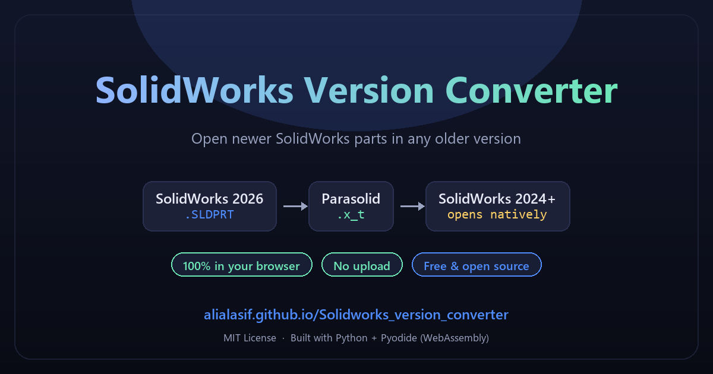
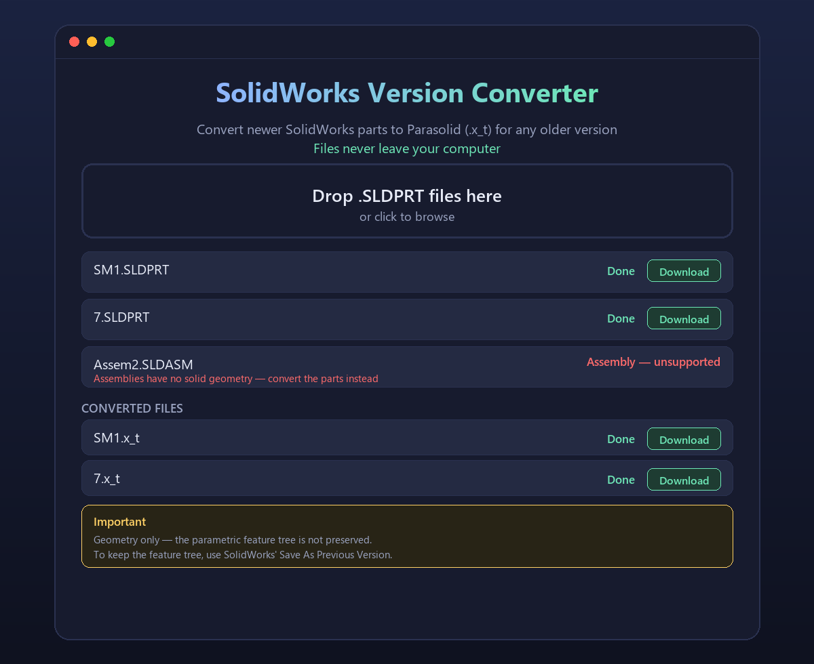

# SolidWorks Version Converter

**Convert SolidWorks future-version CAD files (e.g. saved in SolidWorks 2026) into a format that older SolidWorks versions (e.g. SolidWorks 2024) can open natively.**





*UI preview is illustrative.*

---

## 🌐 Try it in your browser (no install)

A zero-install web version lives in [`web/`](web/) and runs the **same
conversion entirely inside your browser** using
[Pyodide](https://pyodide.org) (Python in WebAssembly).

> 🔒 **Your files never leave your computer** — there is no server and nothing
> is uploaded.

**Live demo:** <https://alialasif.github.io/Solidworks_version_converter/>

To host it yourself, the included workflow
[`.github/workflows/pages.yml`](.github/workflows/pages.yml) deploys the
`web/` folder to **GitHub Pages** automatically:

1. Push to `main`.
2. Go to **Settings → Pages**, set **Source: GitHub Actions**.
3. The site is published at `https://<user>.github.io/<repo>/`.

---

## 🔍 What it does

SolidWorks files saved in a **newer** release cannot be opened by **older** releases. This tool bridges that gap.

It converts SolidWorks `.sldprt` part files into **Parasolid (`.x_t`)** files — the neutral format that SolidWorks 2024 and older open natively — **without needing SolidWorks installed at all**.

```
SolidWorks 2026 file (.sldprt)  ──[ this tool ]──▶  SolidWorks 2024-openable format (.x_t)
```

---

## ✅ Why this is useful

- You have a model made in **SolidWorks 2026**.
- You only have **SolidWorks 2024**.
- SolidWorks 2024 **refuses to open** a 2026 file.
- → Convert to `.x_t` → open in SolidWorks 2024. ✅

---

## 📦 Installation

Requires **Python 3.10+**.

```bash
pip install -e .
# or
pip install sw-version-converter
```

or simply:

```bash
pip install sldprt2xt olefile
```

---

## 🚀 Usage

Convert a whole folder of parts:

```bash
sw-version-converter ./CAD ./converted_2024
```

or with the module:

```bash
python -m sw_version_converter ./CAD ./converted_2024
```

or the convenience wrapper:

```bash
python convert_parts.py ./CAD ./converted_2024
```

### Options

| Flag | Default | Description |
|---|---|---|
| `input` | `./CAD` | Folder containing `.sldprt` files |
| `-o / --output` | `<input>/_converted` | Output folder for `.x_t` files |
| `--source-version` | `2026` | Source SolidWorks version label |
| `--target-version` | `2024` | Target SolidWorks version label |

---

## 🧪 How it works

Under the hood it uses the free, offline [`sldprt2xt`](https://pypi.org/project/sldprt2xt/) package, which:

1. Opens the SolidWorks OLE2 container (both known format generations).
2. Extracts the embedded Parasolid transmit.
3. Writes a clean, valid Parasolid (`.x_t`) file.

The result is geometry-only — see the **Important caveats** below.

---

## ⚠️ Important caveats

### 1. Feature tree is NOT preserved

This tool converts **geometry only**. The parametric feature tree (sketches, Boss-Extrude, Cut-Extrude, fillets, etc.) is not carried over.

**Why?** The feature tree lives in version-specific internal data readable only by the SolidWorks version that created it.

### 2. To preserve the feature tree, use SolidWorks 2026+

SolidWorks 2024 introduced **"Save As Previous Version"** (via the API `AdvancedSaveAsOptions.SaveAsPreviousVersion`), which saves a document to a previous release **as a fully functional document** (feature tree intact).

- Run inside **SolidWorks 2026+**.
- Target: up to **2 releases back** (2026 → 2024 works).
- Requires an **active subscription license**.
- Files with features that didn't exist in 2024 trigger a **"Previous Release Check"** — those features must be removed before saving down.

A SolidWorks macro (`BatchDownsaveTo2024.swb`) is included for this.

### 3. Assemblies

Assemblies (`.sldasm`) are not converted by this tool. The parts inside them are.

---

## 📋 Example

```
CAD/
├── Part2.SLDPRT
├── Boss-Extrude12.SLDPRT
└── Assem2.SLDASM

$ sw-version-converter ./CAD ./converted_2024

============================================================
Source  : ./CAD
Output  : ./converted_2024
Source version : 2026
Target version : 2024
Parts   : 3
============================================================
OK      Part2.SLDPRT -> Part2.x_t
...
Converted: 3   Failed: 0   Skipped: 0
```

---

## 🛠️ Troubleshooting & limitations

### `WriteError: legal_owners: 17 values for 16 elements`
A bug in the underlying `sldprt2xt` library for **older-schema files** (it hard-codes
17 array elements where older SolidWorks files declare 16). **This tool works
around it automatically** by reading the file's real schema size and retrying.
Both the CLI and the browser app include the fix.

### `pas de géométrie Parasolid dans ce fichier` / "no Parasolid geometry"
The file contains no solid geometry. This happens with:
- **Assemblies (`.sldasm`)** — they only reference parts, never store geometry.
  → Convert the **individual `.sldprt` parts** instead, then re-assemble.
- **Drawings (`.slddrw`)** — no solid geometry either.
- **Corrupt or non-SolidWorks files.**

### Feature tree is not preserved
This is **geometry-only**. The parametric history (sketches, extrudes, cuts,
fillets…) is stored in version-specific data readable only by the SolidWorks
version that created it. To keep the feature tree, open the file in the
**newer SolidWorks** and use *Save As Previous Version* (up to 2 releases back,
requires an active subscription).

### "Newer than supported" / schema errors
If a file was saved by a SolidWorks release newer than the `sldprt2xt` schema
tables, update the package (`pip install -U sldprt2xt`), or export a
Parasolid/STEP from a newer SolidWorks.

### Supported file sizes
- **Verified:** a **6.8 MB** part converts in **~18 s** using **~160 MB** of RAM.
- Roughly extrapolating, a **~150 MB** part may reach the browser's practical
  memory limit (WebAssembly is capped near **4 GB**), so it is **not guaranteed**
  and mobile devices are not recommended for large files.
- For very large parts, prefer the **CLI**, which has no browser memory cap.

### The browser page is slow the first time
The first visit downloads the Python runtime (**~15–20 MB**). It is cached
afterwards. Very large parts may take longer and are limited by browser memory.

### Privacy
The **browser app runs entirely on your machine** — files are never uploaded.
The **CLI** is also fully offline. Nothing leaves your computer.

### Licensing
This project is **MIT**. It builds on [`sldprt2xt`](https://pypi.org/project/sldprt2xt/),
which is **AGPL-3.0**; the browser app installs it at runtime rather than
bundling it. Please keep the attribution when you redistribute.

---

## 📄 License

MIT © 2026 Ali Al-Asif
